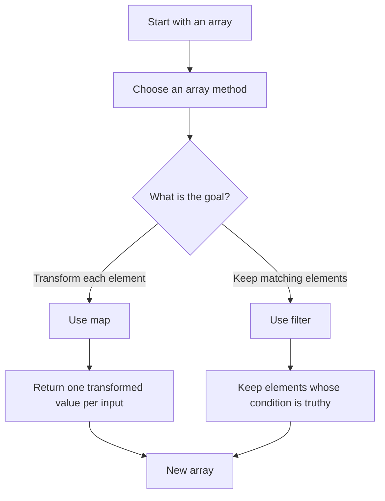
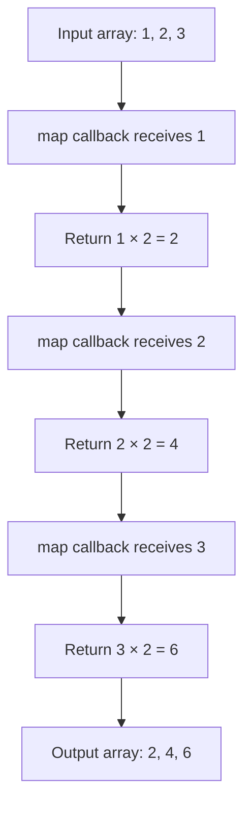
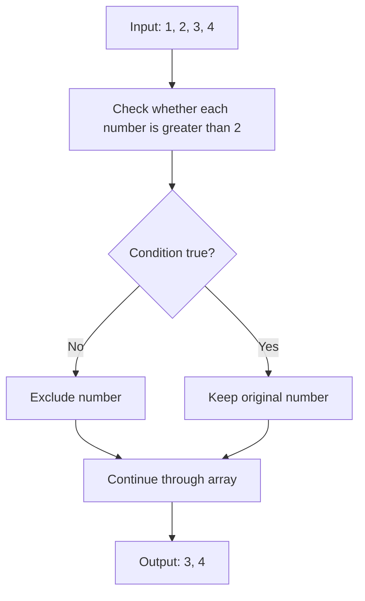
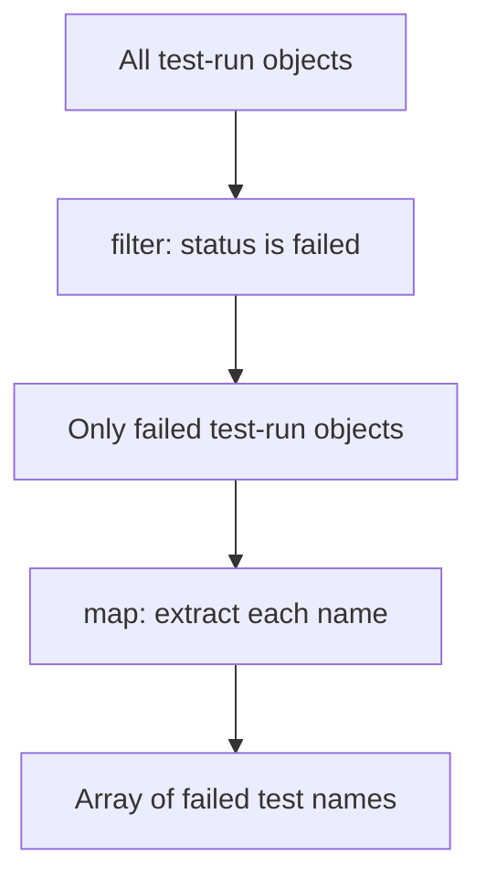
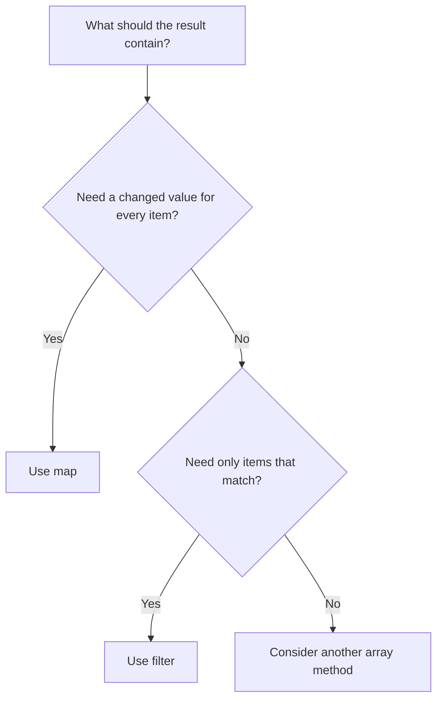

# JavaScript `map()` and `filter()`
## Complete Beginner-to-Confident Study Notes for QA Automation

> **Purpose:** Understand `map()` and `filter()` deeply, explain them in interviews, and use them confidently when working with API responses, test data, and Playwright UI checks.
>
> **GitHub tip:** Save this file as `javascript-map-filter-notes.md` in your repository. GitHub renders Markdown headings, tables, and Mermaid flowcharts.

---

## Table of Contents

1. [Learning goals](#1-learning-goals)
2. [The big picture: arrays and callbacks](#2-the-big-picture-arrays-and-callbacks)
3. [What is `map()`?](#3-what-is-map)
4. [What is `filter()`?](#4-what-is-filter)
5. [Understand arrow functions and conditions](#5-understand-arrow-functions-and-conditions)
6. [`map()` vs `filter()`](#6-map-vs-filter)
7. [Original array and returned array](#7-original-array-and-returned-array)
8. [Step-by-step dry runs](#8-step-by-step-dry-runs)
9. [QA automation examples](#9-qa-automation-examples)
10. [Chaining `filter()` and `map()`](#10-chaining-filter-and-map)
11. [Common mistakes](#11-common-mistakes)
12. [Debugging tips](#12-debugging-tips)
13. [Practice exercises](#13-practice-exercises)
14. [Interview questions and model answers](#14-interview-questions-and-model-answers)
15. [Quick revision sheet](#15-quick-revision-sheet)
16. [Further reading](#16-further-reading)

---

## 1. Learning goals

By the end of these notes, you should be able to:

- Explain what an array is.
- Explain what a callback function is at a beginner level.
- Describe what `map()` does and when to use it.
- Describe what `filter()` does and when to use it.
- Predict the output of both methods.
- Explain the arrow function and condition used in an example.
- Use both methods with objects, API-like data, and Playwright text.
- Combine the methods to select records and then extract values.
- Identify common mistakes and debug unexpected output.

### The most important idea

**`map()` transforms. `filter()` selects.**

```text
Need to change every item?  ──> map()
Need to keep only matches?  ──> filter()
```

---

## 2. The big picture: arrays and callbacks

### 2.1 What is an array?

An array stores multiple values in one variable.

```javascript
const scores = [45, 82, 91, 60, 73];
```

This array contains five numbers. Each value is called an **element**.

| Index | Value |
|---:|---:|
| 0 | 45 |
| 1 | 82 |
| 2 | 91 |
| 3 | 60 |
| 4 | 73 |

JavaScript array indexes start at `0`, not `1`.

### 2.2 What is a callback function?

A callback is a function passed to another function so it can be called when needed. For `map()` and `filter()`, the callback is run for array elements.

```javascript
const scores = [45, 82, 91];

const doubled = scores.map(score => score * 2);
console.log(doubled);
// [90, 164, 182]
```

In `score => score * 2`, the callback receives the current score and returns twice its value.

### 2.3 A simple flow diagram



---

## 3. What is `map()`?

### 3.1 Definition

`map()` runs a callback on each element and builds a new array from the values returned by that callback.

**Key rule:** `map()` produces one output value for each input element. For a normal array of five elements, the resulting array has five elements.

### 3.2 Basic example: double the numbers

```javascript
const numbers = [1, 2, 3, 4];

const doubled = numbers.map(number => number * 2);

console.log(doubled);
// [2, 4, 6, 8]
```

Dry run:

| Current element (`number`) | Operation | Output element |
|---:|---|---:|
| 1 | `1 * 2` | 2 |
| 2 | `2 * 2` | 4 |
| 3 | `3 * 2` | 6 |
| 4 | `4 * 2` | 8 |

### 3.3 Example from the source notes: uppercase test statuses

```javascript
const statuses = ["passed", "failed", "skipped"];

const uppercaseStatuses = statuses.map(status => status.toUpperCase());

console.log(uppercaseStatuses);
// ["PASSED", "FAILED", "SKIPPED"]
```

Explanation:

1. `statuses` is the original array.
2. `map()` takes one status at a time.
3. `status.toUpperCase()` creates an uppercase string.
4. Each returned string goes into the new array.
5. The original array remains `["passed", "failed", "skipped"]`.

### 3.4 Extract a property from objects

```javascript
const users = [
  { id: 1, name: "Asha", role: "admin" },
  { id: 2, name: "Ravi", role: "tester" }
];

const names = users.map(user => user.name);

console.log(names);
// ["Asha", "Ravi"]
```

Each `user` is an object. `user.name` reads the `name` property. The result is an array of names instead of an array of user objects.

### 3.5 Format values with a template literal

```javascript
const products = [
  { name: "Keyboard", price: 50 },
  { name: "Mouse", price: 20 }
];

const productLabels = products.map(
  product => `${product.name}: $${product.price}`
);

console.log(productLabels);
// ["Keyboard: $50", "Mouse: $20"]
```

The backticks create a **template literal**. Expressions inside `${...}` are inserted into the resulting string.

### 3.6 `map()` flow diagram



### 3.7 When should you use `map()`?

Use `map()` when you need to:

- Convert every status to uppercase.
- Extract names or IDs from objects.
- Format data into labels.
- Prepare expected values for assertions.
- Convert one representation of data into another.

Do **not** choose `map()` merely because you need to check a condition. If you want to keep only matching items, consider `filter()`.

---

## 4. What is `filter()`?

### 4.1 Definition

`filter()` runs a callback on array elements and creates a new array containing only the original elements whose callback result is truthy.

**Key rule:** An item is kept when the callback's result is truthy. An item is left out when the result is falsy. The output can be shorter than the input, or even empty.

### 4.2 Basic example: keep numbers greater than 2

```javascript
const numbers = [1, 2, 3, 4];

const biggerNumbers = numbers.filter(number => number > 2);

console.log(biggerNumbers);
// [3, 4]
```

Dry run:

| Current element | Is `number > 2` true? | Result |
|---:|---|---|
| 1 | No | Excluded |
| 2 | No | Excluded |
| 3 | Yes | Kept |
| 4 | Yes | Kept |

### 4.3 Example from the source notes: keep failed statuses

```javascript
const statuses = ["passed", "failed", "skipped"];

const failedStatuses = statuses.filter(status => status === "failed");

console.log(failedStatuses);
// ["failed"]
```

The condition `status === "failed"` is true only for the `"failed"` element, so only that element is kept.

### 4.4 Filter objects by a property

```javascript
const users = [
  { name: "Asha", active: true },
  { name: "Ravi", active: false },
  { name: "Meera", active: true }
];

const activeUsers = users.filter(user => user.active);

console.log(activeUsers);
// [
//   { name: "Asha", active: true },
//   { name: "Meera", active: true }
// ]
```

Because `user.active` is `true` for Asha and Meera, those two original objects are kept. Ravi's object is excluded.

This is a common JavaScript pattern: a boolean property can itself be used as the filter condition.

### 4.5 `filter()` flow diagram



### 4.6 When should you use `filter()`?

Use `filter()` when you need to:

- Keep failed test runs.
- Select active users.
- Find products above a price threshold.
- Select enabled or visible records.
- Narrow a list before making assertions.

---

## 5. Understand arrow functions and conditions

Many examples use this form:

```javascript
item => item > 70
```

This is an **arrow function**. It accepts `item` and returns the result of `item > 70`.

### 5.1 Arrow function in a longer form

These two forms are equivalent for this example:

```javascript
const isPassing = item => item > 70;
```

```javascript
const isPassing = (item) => {
  return item > 70;
};
```

The first uses the concise form. The second uses braces and an explicit `return`.

### 5.2 The ternary operator

The source example uses:

```javascript
item_score => item_score > 70 ? "Pass" : "Fail"
```

Read it as:

```text
condition ? value_if_true : value_if_false
```

Equivalent longer form:

```javascript
item_score => {
  if (item_score > 70) {
    return "Pass";
  } else {
    return "Fail";
  }
}
```

### 5.3 Source example: grades with `map()`

```javascript
const scores = [45, 82, 91, 60, 73];

const grades = scores.map(
  item_score => item_score > 70 ? "Pass" : "Fail"
);

console.log(grades);
// ["Fail", "Pass", "Pass", "Fail", "Pass"]
```

Dry run:

| Score | Is score greater than 70? | Grade |
|---:|---|---|
| 45 | No | `"Fail"` |
| 82 | Yes | `"Pass"` |
| 91 | Yes | `"Pass"` |
| 60 | No | `"Fail"` |
| 73 | Yes | `"Pass"` |

Notice that the condition is `> 70`, not `>= 70`. A score of exactly `70` would produce `"Fail"`.

### 5.4 Source example: passing scores with `filter()`

```javascript
const scores = [45, 82, 91, 60, 73];

const passing = scores.filter(s => s >= 70);

console.log(passing);
// [82, 91, 73]
```

Here the condition is `>= 70`, so a score of exactly `70` would be included.

### 5.5 Why do the outputs differ?

- The `map()` example transforms all five scores into labels. It returns five strings.
- The `filter()` example keeps only scores that are at least 70. It returns three numbers.

**Important:** The two examples use slightly different conditions: `> 70` versus `>= 70`.

---

## 6. `map()` vs `filter()`

| Question | `map()` | `filter()` |
|---|---|---|
| What is the goal? | Transform each element | Select matching elements |
| What does the callback usually return? | A new value | A truthy/falsy condition |
| Does each input produce an output position? | Yes | Only if it matches |
| Can the output be shorter? | Not normally; one result per input element | Yes |
| Does it mutate the original array? | No | No |
| Typical example | `users.map(user => user.name)` | `users.filter(user => user.active)` |

### Side-by-side example

```javascript
const scores = [45, 82, 91, 60, 73];

const labels = scores.map(score => score >= 70 ? "Pass" : "Fail");
console.log(labels);
// ["Fail", "Pass", "Pass", "Fail", "Pass"]

const passingScores = scores.filter(score => score >= 70);
console.log(passingScores);
// [82, 91, 73]
```

The first array contains a label for every score. The second array contains only the scores that pass the condition.

---

## 7. Original array and returned array

Both methods create a new array. They do not replace or mutate the original array themselves.

```javascript
const numbers = [1, 2, 3];

const doubled = numbers.map(n => n * 2);
const numbersOverOne = numbers.filter(n => n > 1);

console.log(numbers);        // [1, 2, 3]
console.log(doubled);        // [2, 4, 6]
console.log(numbersOverOne); // [2, 3]
```

The original `numbers` array remains unchanged.

### A useful distinction

The methods create a new array, but when the elements are objects, `filter()` keeps references to the original objects rather than cloning each object. These methods also do not prevent a callback from mutating an object; avoid side effects in callbacks when possible.

For beginner-level work, remember: **the array returned by the method is new, but object elements may still be shared references.**

---

## 8. Step-by-step dry runs

A dry run means tracing the code manually to predict the result.

### Dry run A: `map()`

```javascript
const values = [2, 4, 6];
const result = values.map(value => value + 1);
console.log(result);
```

| Pass | `value` | Expression | Stored result |
|---:|---:|---|---:|
| 1 | 2 | `2 + 1` | 3 |
| 2 | 4 | `4 + 1` | 5 |
| 3 | 6 | `6 + 1` | 7 |

Output: `[3, 5, 7]`

### Dry run B: `filter()`

```javascript
const values = [2, 4, 6];
const result = values.filter(value => value > 3);
console.log(result);
```

| Pass | `value` | Is `value > 3` true? | Action |
|---:|---:|---|---|
| 1 | 2 | No | Exclude |
| 2 | 4 | Yes | Keep 4 |
| 3 | 6 | Yes | Keep 6 |

Output: `[4, 6]`

### Dry-run checklist

1. Write down the original array.
2. Take one element at a time.
3. Substitute it into the callback.
4. For `map()`, write the returned value.
5. For `filter()`, decide whether to keep or exclude the original element.
6. Collect the results in order.

---

## 9. QA automation examples

### 9.1 Extract names from an API response

```javascript
const users = [
  { id: 1, name: "Asha", role: "admin" },
  { id: 2, name: "Ravi", role: "tester" }
];

const names = users.map(user => user.name);

console.log(names);
// ["Asha", "Ravi"]

expect(names).toEqual(["Asha", "Ravi"]);
```

**QA use:** Convert a response containing objects into a simple list of expected names, IDs, or statuses.

### 9.2 Select active users

```javascript
const users = [
  { name: "Asha", active: true },
  { name: "Ravi", active: false },
  { name: "Meera", active: true }
];

const activeUsers = users.filter(user => user.active);

expect(activeUsers).toHaveLength(2);
```

**QA use:** Select records that are active, enabled, or in a required state.

### 9.3 Filter button text in Playwright

```javascript
const buttonTexts = await page.getByRole("button").allTextContents();

const saveButtons = buttonTexts.filter(text =>
  text.trim().toLowerCase().includes("save")
);

expect(saveButtons.length).toBeGreaterThan(0);
```

**What happens?**

1. Playwright reads text from the page's buttons.
2. The text values form an array.
3. `filter()` keeps strings containing `"save"` regardless of case.
4. The assertion checks that at least one matching text exists.

For example, `"Save"`, `"Save changes"`, and `"save profile"` match. The example filters **button text strings**; it does not return button locator objects.

### 9.4 Format product data

```javascript
const products = [
  { name: "Keyboard", price: 50 },
  { name: "Mouse", price: 20 }
];

const productLabels = products.map(
  product => `${product.name}: $${product.price}`
);

console.log(productLabels);
// ["Keyboard: $50", "Mouse: $20"]
```

**QA use:** Prepare readable labels or expected values for assertions.

### 9.5 Get names of failed test runs

```javascript
const testRuns = [
  { name: "login", status: "passed" },
  { name: "checkout", status: "failed" },
  { name: "search", status: "failed" }
];

const failedTestNames = testRuns
  .filter(test => test.status === "failed")
  .map(test => test.name);

console.log(failedTestNames);
// ["checkout", "search"]
```

**QA use:** First select failed records; then extract only their names.

---

## 10. Chaining `filter()` and `map()`

Chaining means calling one method after the result of another method.

```javascript
const result = testRuns
  .filter(test => test.status === "failed")
  .map(test => test.name);
```

Read it from top to bottom:



### Why this order?

- `filter()` reduces the list to records you want.
- `map()` transforms those remaining records into the values you need.

If you map first to names, you lose the status property in the resulting strings, so filtering by status afterward would no longer work in the same way.

---

## 11. Common mistakes

### Mistake 1: Expecting `map()` to remove elements

```javascript
const numbers = [1, 2, 3, 4];

const result = numbers.map(n => n > 2);

console.log(result);
// [false, false, true, true]
```

This does not remove values. It transforms every number into a boolean.

If you want the numbers greater than 2, use:

```javascript
const result = numbers.filter(n => n > 2);
// [3, 4]
```

### Mistake 2: Forgetting what the callback returns

```javascript
const numbers = [1, 2, 3];

const result = numbers.map(n => n * 2);
```

The callback returns the result of `n * 2`, not the original number.

### Mistake 3: Confusing `>` and `>=`

```javascript
const scores = [69, 70, 71];

console.log(scores.filter(score => score > 70));
// [71]

console.log(scores.filter(score => score >= 70));
// [70, 71]
```

- `>` means strictly greater than.
- `>=` means greater than or equal to.

### Mistake 4: Using assignment instead of comparison

Use `===` to compare values:

```javascript
status => status === "failed"
```

Do not accidentally use `=` when you intend to compare. `=` assigns a value.

### Mistake 5: Expecting `filter()` to return `true` or `false`

```javascript
const numbers = [1, 2, 3];
const result = numbers.filter(n => n > 1);

console.log(result);
// [2, 3]
```

`filter()` uses the condition to decide which original elements to keep. It returns the elements, not a list of condition results.

### Mistake 6: Forgetting the output type

- `map(user => user.name)` returns names, usually strings.
- `filter(user => user.active)` returns user objects that match.

Always ask: **What does my callback return, and what type of value do I want at the end?**

---

## 12. Debugging tips

### Tip 1: Log the input and output

```javascript
console.log("Original:", scores);

const passing = scores.filter(score => score >= 70);

console.log("Passing:", passing);
```

### Tip 2: Test the condition by itself

```javascript
console.log(45 >= 70); // false
console.log(82 >= 70); // true
```

### Tip 3: Use descriptive variable names

Instead of:

```javascript
const x = users.filter(u => u.a);
```

Prefer:

```javascript
const activeUsers = users.filter(user => user.active);
```

Clear names make code easier to read, debug, and explain during interviews.

### Tip 4: Check the expected result

For `map()`, count one output per input element.

For `filter()`, check each element against the condition and keep only the matches.

---

## 13. Practice exercises

Try solving each exercise before checking the answer key.

### Exercise 1 — `map()`

What is the output?

```javascript
const numbers = [3, 5, 7];
const result = numbers.map(number => number * 3);
console.log(result);
```

### Exercise 2 — `filter()`

What is the output?

```javascript
const numbers = [3, 5, 7, 9];
const result = numbers.filter(number => number >= 7);
console.log(result);
```

### Exercise 3 — Status conversion

Convert each status to uppercase.

```javascript
const statuses = ["passed", "failed", "skipped"];

// Write your code here.
```

### Exercise 4 — Select active records

Return only the active user objects.

```javascript
const users = [
  { name: "Asha", active: true },
  { name: "Ravi", active: false },
  { name: "Meera", active: true }
];

// Write your code here.
```

### Exercise 5 — Extract names

Return an array containing only the names.

```javascript
const users = [
  { id: 1, name: "Asha" },
  { id: 2, name: "Ravi" }
];

// Write your code here.
```

### Exercise 6 — Combine both methods

Return the names of failed tests only.

```javascript
const tests = [
  { name: "login", status: "passed" },
  { name: "checkout", status: "failed" },
  { name: "search", status: "failed" }
];

// Write your code here.
```

### Exercise 7 — Boundary condition

What is the output of each line?

```javascript
const scores = [69, 70, 71];

console.log(scores.filter(score => score > 70));
console.log(scores.filter(score => score >= 70));
```

### Answer key

<details>
<summary>Exercise 1 answer</summary>

```javascript
[9, 15, 21]
```

Each element is multiplied by 3.
</details>

<details>
<summary>Exercise 2 answer</summary>

```javascript
[7, 9]
```

Only values greater than or equal to 7 are kept.
</details>

<details>
<summary>Exercise 3 answer</summary>

```javascript
const uppercaseStatuses = statuses.map(status => status.toUpperCase());
```

Output: `["PASSED", "FAILED", "SKIPPED"]`
</details>

<details>
<summary>Exercise 4 answer</summary>

```javascript
const activeUsers = users.filter(user => user.active);
```

Asha and Meera remain in the result.
</details>

<details>
<summary>Exercise 5 answer</summary>

```javascript
const names = users.map(user => user.name);
```

Output: `["Asha", "Ravi"]`
</details>

<details>
<summary>Exercise 6 answer</summary>

```javascript
const failedNames = tests
  .filter(test => test.status === "failed")
  .map(test => test.name);
```

Output: `["checkout", "search"]`
</details>

<details>
<summary>Exercise 7 answer</summary>

```javascript
[71]
[70, 71]
```

The second condition includes 70; the first does not.
</details>

---

## 14. Interview questions and model answers

### Q1. What is `map()`?

`map()` is an array method that runs a callback on each element and returns a new array containing the callback's returned values. It produces one result per input element.

### Q2. What is `filter()`?

`filter()` is an array method that returns a new array containing the original elements for which the callback returns a truthy result.

### Q3. What is the main difference between `map()` and `filter()`?

`map()` transforms each element. `filter()` chooses which elements to keep.

### Q4. Do these methods change the original array?

Neither method mutates the original array by itself. However, callback code can still have side effects, and object elements can be shared references.

### Q5. Can `filter()` return an empty array?

Yes. If no element satisfies the condition, it returns `[]`.

```javascript
[1, 2, 3].filter(n => n > 10);
// []
```

### Q6. Does `map()` always return the same number of elements?

For ordinary arrays, it returns one result for each element visited, so the output has the same length as the input.

### Q7. Why combine `filter()` and `map()`?

Use `filter()` to select records and `map()` to extract or transform values from those records.

### Q8. Give a QA automation use case for `map()`.

Extract names or IDs from an API response so they can be compared with expected values in an assertion.

### Q9. Give a QA automation use case for `filter()`.

Select active users, failed test records, or UI text matching a condition.

### Q10. What does this code return?

```javascript
const scores = [45, 82, 91, 60, 73];
const result = scores.map(score => score >= 70);
```

It returns:

```javascript
[false, true, true, false, true]
```

`map()` transforms every score into a boolean. It does not remove the scores that fail.

### Q11. What is a callback?

A callback is a function passed to another function so that the receiving function can call it. In `map()` and `filter()`, it defines what to do with or how to evaluate each element.

### Q12. What does `user => user.name` mean?

It is an arrow function that receives an item called `user` and returns its `name` property.

---

## 15. Quick revision sheet

### Memorize these patterns

```javascript
// Transform each item
const transformed = array.map(item => transform(item));

// Keep matching items
const selected = array.filter(item => condition(item));

// Select first, then transform
const result = array
  .filter(item => condition(item))
  .map(item => transform(item));
```

### Final decision flow



### Last-minute memory trick

| If you want to… | Use |
|---|---|
| Convert every string to uppercase | `map()` |
| Extract every user's name | `map()` |
| Format each product label | `map()` |
| Keep only active users | `filter()` |
| Keep only failed tests | `filter()` |
| Get names of failed tests | `filter()` followed by `map()` |

---

## 16. Further reading

The original notes point to these MDN references:

- [`Array.prototype.map()` — MDN](https://developer.mozilla.org/en-US/docs/Web/JavaScript/Reference/Global_Objects/Array/map)
- [`Array.prototype.filter()` — MDN](https://developer.mozilla.org/en-US/docs/Web/JavaScript/Reference/Global_Objects/Array/filter)

Use these for formal definitions and additional JavaScript examples.

---

## Source and scope note

These notes preserve the original `MapFilter.md` topics and examples: status conversion, failed-status filtering, extracting API user names, selecting active users, filtering Playwright button text, formatting product labels, chaining the methods for failed test names, and the common mistake of using `map()` when you need selection.

Additional explanations, dry runs, flowcharts, exercises, and interview questions have been added to make the material easier to study. The code examples are educational; the `expect(...)` assertions assume a compatible test framework such as Playwright Test.
